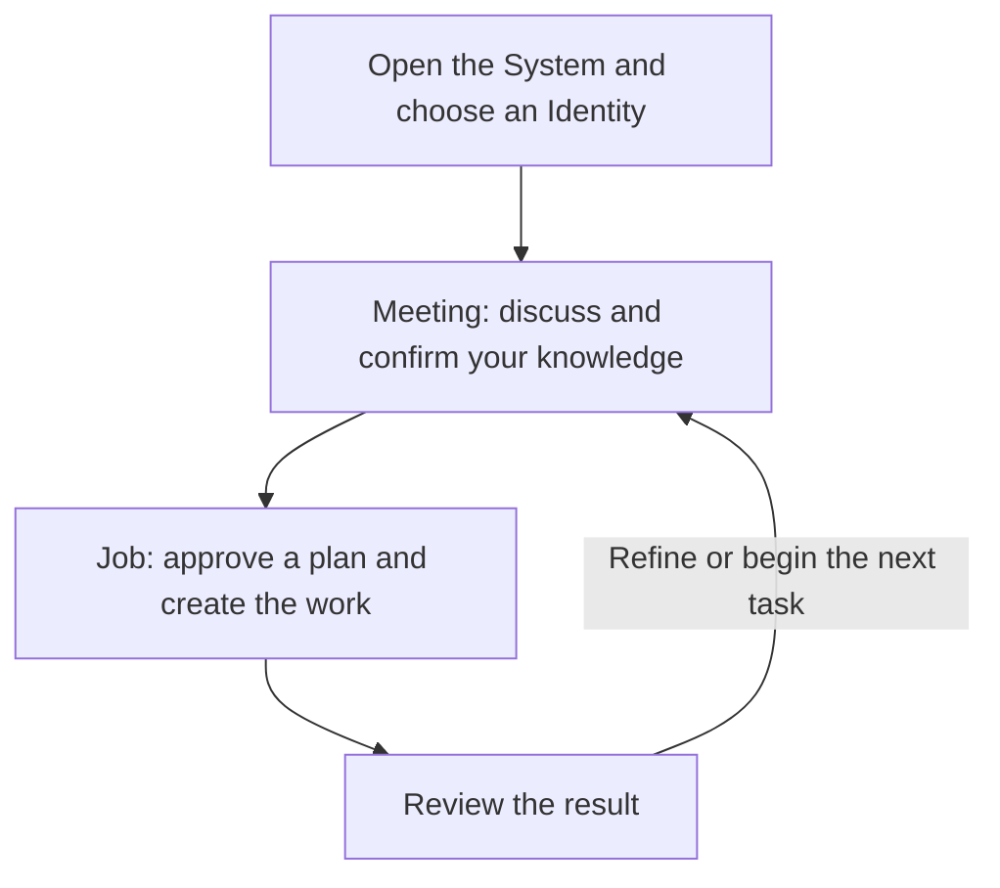
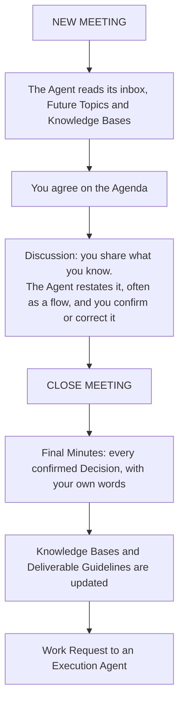
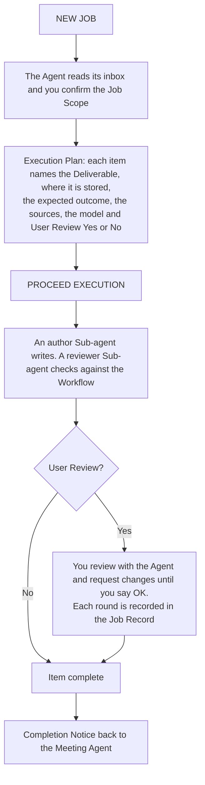

# AI with ME

AI with ME - Operating Framework lets you work with a team of AI Agents the way you work with a team of people. You organise AI Agents into Identities, each responsible for one area, like the departments of a company. You discuss and decide in Meetings. Execution Agents turn those decisions into finished work, such as a book, a business document, a website or a plan. Every decision and record stays in your own Google Drive, so the work continues across conversations and AI platforms.

## Core ideas

- **Identity.** Each AI Agent works as an Identity: a named assignment with its own Scope. Identities work side by side and hand work to each other.
- **Meetings and Jobs.** Meeting Agents explore ideas with you and record confirmed decisions in Final Minutes. Execution Agents turn those Minutes into the agreed work, with quality checks.
- **Records you own.** System Context, each Identity's context, the records, the indexes and the inboxes live in your Google Drive. Their structure is in English. Their content keeps the language you used, and your own words stay untranslated.
- **Knowledge Transfer.** What you know becomes clear written knowledge that people and AI can read, keep and use. Knowledge Bases hold it by subject.
- **Experience.** The System learns from your corrections and from what works. Every Identity can use those lessons.
- **Writing Rules.** Every Agent writes under shared Global Writing Rules. Final Minutes, Knowledge Bases and text Deliverables are checked against them before they are saved.

## How it works

You start and steer each stage with four words: `NEW MEETING`, `CLOSE MEETING`, `NEW JOB` and `PROCEED EXECUTION`. The [Requirements](requirements/README.md) define the complete flow, responsibilities and approvals.

## Working with the two Agent Roles

Every Identity has one of two Roles. A Meeting Agent helps you think and decide. An Execution Agent produces the work you decided on.

**Focus on the Meeting Agent.** It is where your own knowledge enters the System. You talk freely, and the Meeting Agent turns what you know, want and decide into clear written records. Execution can only be as good as those records. The time you spend in Meetings is the time that makes every later Job better.

### Meeting Agent

A Meeting Agent organises discussion, research, planning and decisions for its Scope. It records only what you confirm, keeps your own words, and hands the agreed work to an Execution Agent.

### Execution Agent

An Execution Agent turns Final Minutes into finished Deliverables. It plans the whole Job, waits for your approval, and uses Sub-agents to write and review the work.

When your review changes something that a Meeting decided, the Job Record marks it. The Meeting Agent reads the Job Record and asks you where the change belongs, so the chain runs both ways.

## Requirements

| Dependency | Need | Purpose |
| --- | --- | --- |
| Claude or ChatGPT with plugin support | Required | Runs the Plugin and its eleven Skills. |
| Google Drive and Google Docs connectors | Required | Hold the System, each Identity's context and every record. The Plugin does not ship them. |
| An Agent workspace | Optional | A writable folder, in the cloud or on your device, where Agents keep working records before they sync to Google. |
| GitHub, GitLab or another store | Optional | Holds a Deliverable when Google Drive does not fit it. |

## Installation

The steps differ between Claude and ChatGPT.

### Claude (chat, desktop app or Cowork)

1. Open **Customize** → **Plugins**.
2. Select **Add** → **Add custom marketplace**.
3. Enter the GitHub URL: `https://github.com/bonchiang96/AI-with-ME`.
4. Claude shows the available plugin. Select **ai-with-me** to add it.

The plugin is ready to use. It also syncs to Claude Code under the same account.

### ChatGPT (chat or work)

1. Give ChatGPT the repository URL: `https://github.com/bonchiang96/AI-with-ME`.
2. Ask it to create a private plugin with **Plugin Creator** from every file in the `plugin/` folder, keeping the folder structure.
3. Check that the private plugin lists all eleven Skills.

Do not use the Codex CLI for this. It installs into that environment, not your account.

### Claude Code or Codex

Follow [INSTALL.md](INSTALL.md).

Missing Google access never blocks installation.

## Configuration

Your settings live in **Google System Rules**, inside the Google Drive folder named **AI with me**. The first run creates the file with starter rules for documents, Tab names and the date format. Add your own rules there. They take priority over the Plugin.

## Quick start

1. Start a conversation with the `ai-with-me` Skill. In Claude, type `/ai-with-me`. In ChatGPT, select the plugin with `@` and ask to enter AI with ME. The Skill checks Google access and looks for the **AI with me** folder.
2. If the folder does not exist, a first Meeting builds the System with you. It creates System Context, Google System Rules, a Knowledge Base folder and two starting Identities: `general-meeting` and `general-execution`.
3. Choose an Identity. Say `NEW MEETING` to a Meeting Agent or `NEW JOB` to an Execution Agent.
4. Keep one Identity per conversation. To work as another Identity, start a new conversation.

## What's inside

| Part | Skills |
| --- | --- |
| Entry | `ai-with-me` |
| Roles | `meeting-agent`, `execution-agent` |
| Records and knowledge | `inbox`, `knowledge-base` |
| Workflows | `workflow-book`, `workflow-business-document`, `workflow-qa`, `profit-a` |
| Rules | `global-writing-rules`, `global-communication-rules` |

The Plugin also ships ten Google Docs templates.

## Resources

| Resource | What you will find |
| --- | --- |
| [plugin/](plugin/) | The installable Plugin: Skills, rules and templates. |
| [requirements/](requirements/README.md) | The full Framework specification. |
| [INSTALL.md](INSTALL.md) | Installation, dependencies and updates. |

To update, reinstall the Plugin from a chosen commit. Updates never change your Google records. GitHub commit history records every change.

## License

Released under the [MIT License](LICENSE).
