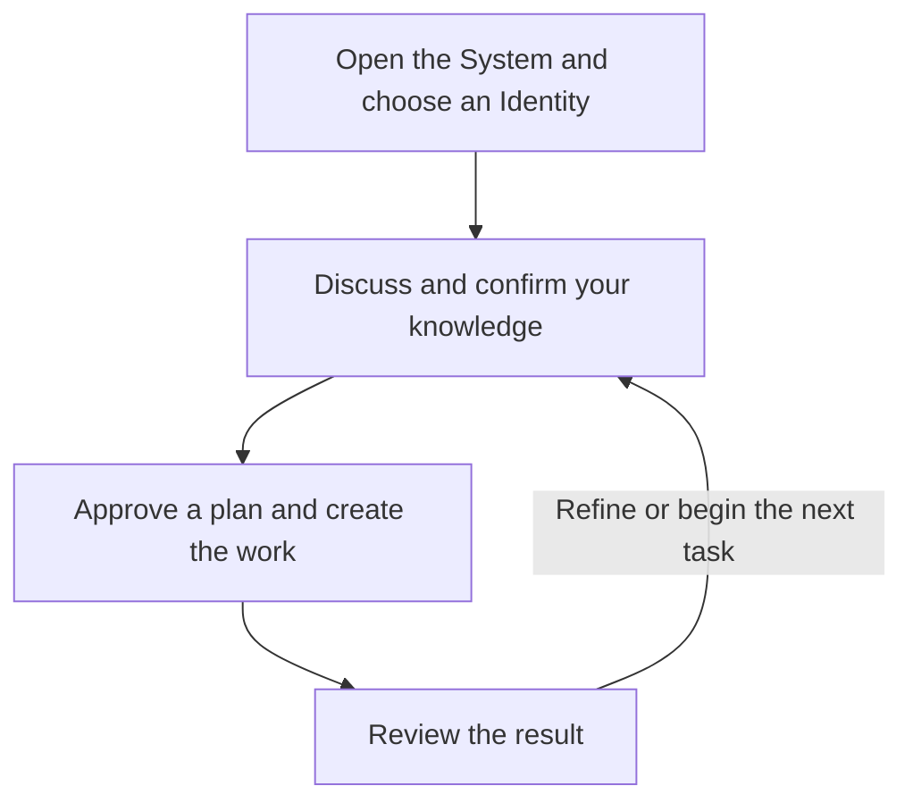

# AI with ME - Operating Framework

AI with ME helps you put your knowledge into words that other people and AI Agents can understand and use. Its core purpose is **knowledge transfer**: preserving what you mean as ideas become decisions, documents and finished work.

You might use it to develop a book, a proposal, a policy, or other work that needs continuity across conversations. The Framework combines reusable Plugin instructions with shared knowledge and records in Google Drive.

## 1. How it works

The central Google Drive folder, **AI with me**, provides the starting point for choosing the Identity for your work.

Meeting Agents help you explore ideas and confirm their meaning. Execution Agents create the agreed work with quality checks. You make the final decisions, and reviews give you space to correct or refine the result.

Each AI works through an **Identity**: its named assignment and scope. Its **Identity Context** is the starting point for continuing that work. **Knowledge Bases** hold reusable subject knowledge, while recorded meeting decisions provide instructions for specific work.

The [Requirements](requirements/README.md) define the complete operating flow, responsibilities and approval boundaries.

## 2. What you need

| Dependency | Purpose |
| --- | --- |
| **Required: an AI environment** | ChatGPT, a suitable local environment, or another supported host with the necessary tools and permissions. |
| **Required: Google Drive / Docs access** | The shared home for System Context, Identity Contexts, Knowledge Bases and authoritative records. |
| **Optional: Database services** | Indexes, search, Agent Messaging and handoff support. |

Local environments use the same central Google System. Their working files and synchronization follow the applicable System Rules. Without Database Messaging, you can pass copy-ready handoff text between the Agents' conversations yourself.

## 3. Getting started

Use the [installation guide](INSTALL.md) to create, manually install or update your Private Plugin from this repository. An AI can help assess your environment and assist through its available tools. The [Plugin package](plugin/) contains the shared Skills, rules and templates.

## 4. Resources

This repository is the development and distribution source for the Framework's Plugin and reusable operating resources. GitHub commit history records changes.

| Resource | What you will find | Status |
| --- | --- | --- |
| [Requirements](requirements/README.md) | The full Framework specification. | Available |
| [Plugin](plugin/) | The Plugin package with shared Skills, rules and templates. | Available |
| [Installation](INSTALL.md) | Private installation and manual updates. | Available |
| `documentation/` | Detailed concepts, operating guidance and environment references. | Planned |

The installed Plugin is intended to supply reusable instructions for normal work. Google resources provide current knowledge, context and records. Intentional Plugin updates use the repository source.

## 5. License

This repository uses the [MIT License](LICENSE).
