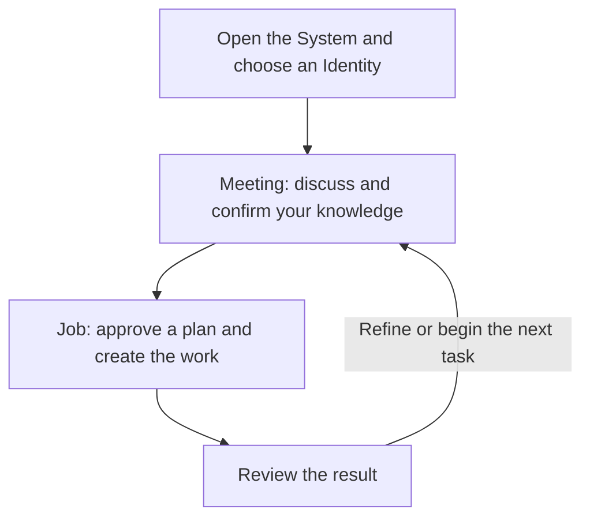

# Turn your knowledge into work that people and AI can use

AI with ME - Operating Framework helps you put your knowledge into words that other people and AI Agents can understand. You decide, and AI Agents carry your meaning from discussion to finished work, such as a book, a business document or a plan. Every decision and record stays in your own Google Drive, so work continues across conversations.

## How it works

Each AI works as an **Identity**, a named assignment with its own scope. Two roles share the work:

- **Meeting Agents** explore ideas with you and record confirmed decisions in Final Minutes.
- **Execution Agents** turn those Minutes into the agreed work, with quality checks.

You start and steer each stage with four words: `NEW MEETING`, `CLOSE MEETING`, `NEW JOB` and `PROCEED EXECUTION`. The [Requirements](requirements/README.md) define the complete flow, responsibilities and approvals.

## Requirements

| Dependency | Need | Purpose |
| --- | --- | --- |
| Claude or ChatGPT with plugin support | Required | Runs the Plugin and its nine Skills. |
| Google Drive and Google Docs connectors | Required | Hold the System, each Identity's context and every record. The Plugin does not ship them. |
| A local environment | Optional | Lets Agents work locally. Records still return to Google. |
| GitHub, GitLab or another store | Optional | Holds a Deliverable when Google Drive does not fit it. |

## Installation

The steps differ between Claude and ChatGPT.

### Claude (chat, desktop app or Cowork)

1. Open **Customize** → **Plugins**.
2. Select **Add** → **Add custom marketplace**.
3. Enter the GitHub URL: `https://github.com/bonchiang96/AI-with-ME`.
4. Claude shows the available plugin. Select **ai-with-me** to add it.

The plugin is ready to use. It also syncs to Claude Code under the same account.

### ChatGPT (chat or work)

1. Give ChatGPT the repository URL: `https://github.com/bonchiang96/AI-with-ME`.
2. Ask it to create a private plugin with **Plugin Creator** from every file in the `plugin/` folder, keeping the folder structure.
3. Check that the private plugin lists all nine Skills.

Do not use the Codex CLI for this. It installs into that environment, not your account.

### Claude Code or Codex

Follow [INSTALL.md](INSTALL.md).

Missing Google access never blocks installation.

## Configuration

Your settings live in **Google System Rules**, inside the Google Drive folder named **AI with me**. The first run creates the file with starter rules for documents, Tab names and the date format. Add your own rules there. They take priority over the Plugin.

## Quick start

1. Start a conversation with the `ai-with-me` Skill. In Claude, type `/ai-with-me`. In ChatGPT, select the plugin with `@` and ask to enter AI with ME. The Skill checks Google access and looks for the **AI with me** folder.
2. If the folder does not exist, a first Meeting builds the System with you. It creates System Context, Google System Rules, a Knowledge Base folder and two starting Identities: `general-meeting` and `general-execution`.
3. Choose an Identity. Say `NEW MEETING` to a Meeting Agent or `NEW JOB` to an Execution Agent.
4. Keep one Identity per conversation. To work as another Identity, start a new conversation.

## What's inside

| Part | Skills |
| --- | --- |
| Entry | `ai-with-me` |
| Roles | `meeting-agent`, `execution-agent` |
| Records and knowledge | `inbox`, `knowledge-base` |
| Workflows | `workflow-book`, `workflow-business-document`, `workflow-qa`, `profit-a` |

The Plugin also ships the Global Writing Rules, the Global Communication Rules and ten Google Docs templates.

## Resources

| Resource | What you will find |
| --- | --- |
| [plugin/](plugin/) | The installable Plugin: Skills, rules and templates. |
| [requirements/](requirements/README.md) | The full Framework specification. |
| [INSTALL.md](INSTALL.md) | Installation, dependencies and updates. |

To update, reinstall the Plugin from a chosen commit. Updates never change your Google records. GitHub commit history records every change.

## License

Released under the [MIT License](LICENSE).
